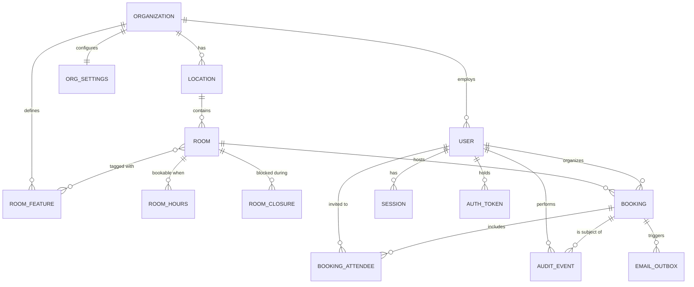

# 03 — Data Model

## 1. Entity relationship diagram



## 2. Entity reference

### `organizations`
The tenant. One row in v1, but every scoped table carries `organization_id`.

| Column | Type | Notes |
|--------|------|-------|
| `id` | uuid PK | |
| `name` | text | Displayed in the UI header and email signatures |
| `slug` | text unique | Reserved for future subdomain routing |
| `default_timezone` | text | IANA name, e.g. `Africa/Addis_Ababa` |
| `logo_url` | text null | Shown in emails |
| `created_at` / `updated_at` | timestamptz | |

### `org_settings`
Separated from `organizations` so that policy changes do not touch identity rows.

| Column | Type | Default | Notes |
|--------|------|---------|-------|
| `organization_id` | uuid PK FK | | One row per org |
| `business_hours_start` | time | `08:00` | Org-wide default; rooms may override |
| `business_hours_end` | time | `18:00` | |
| `business_days` | int[] / csv | `1,2,3,4,5` | ISO weekdays, Monday = 1 |
| `slot_granularity_minutes` | int | `15` | Grid step in the UI |
| `min_booking_minutes` | int | `15` | |
| `max_booking_minutes` | int | `480` | |
| `max_advance_days` | int | `90` | How far ahead an employee may book |
| `min_notice_minutes` | int | `0` | Lead time required before start |
| `reminder_lead_minutes` | int | `15` | D7 |
| `notify_attendees` | bool | `true` | D6 |
| `allow_external_attendees` | bool | `true` | |
| `booking_retention_months` | int | `24` | D8 |
| `email_from_name` / `email_from_address` | text | | Envelope identity |

### `users`

| Column | Type | Notes |
|--------|------|-------|
| `id` | uuid PK | |
| `organization_id` | uuid FK | |
| `email` | citext / text | **Unique per org, stored lower-cased** |
| `password_hash` | text null | Null until an invitation is accepted, and for future SSO-only users |
| `full_name` | text | |
| `role` | enum | `EMPLOYEE` \| `ADMIN` \| `OWNER` |
| `status` | enum | `INVITED` \| `ACTIVE` \| `DISABLED` |
| `timezone` | text null | Overrides the location zone for display only |
| `email_opt_out_reminders` | bool | US-N8 |
| `last_login_at` | timestamptz null | |
| `failed_login_count` | int | Reset on success |
| `locked_until` | timestamptz null | FR-1.4 |
| `created_at` / `updated_at` | timestamptz | |

A `DISABLED` user cannot log in. Their past bookings remain and still display their name;
their **future** bookings are surfaced to the admin at deactivation time so they can be
reassigned or cancelled.

### `sessions`

| Column | Type | Notes |
|--------|------|-------|
| `id` | text PK | Opaque random 256-bit identifier, the cookie value |
| `user_id` | uuid FK | |
| `data` | json | `express-session` payload |
| `ip` / `user_agent` | text | Shown on the "active sessions" account screen |
| `expires_at` | timestamptz | Indexed; swept nightly |

### `auth_tokens`
Covers both invitations and password resets.

| Column | Type | Notes |
|--------|------|-------|
| `id` | uuid PK | |
| `user_id` | uuid FK | |
| `purpose` | enum | `INVITE` \| `PASSWORD_RESET` |
| `token_hash` | text | SHA-256 of the token. **The raw token is only ever in the email** |
| `expires_at` | timestamptz | 72 h for invites, 1 h for resets |
| `consumed_at` | timestamptz null | Single use |

### `locations`

| Column | Type | Notes |
|--------|------|-------|
| `id` | uuid PK | |
| `organization_id` | uuid FK | |
| `name` | text | "Head Office", "Bole Branch" |
| `address` | text null | Included in emails so visitors can find it |
| `timezone` | text | IANA; defaults from the organization |
| `is_active` | bool | |

### `rooms`

| Column | Type | Notes |
|--------|------|-------|
| `id` | uuid PK | |
| `organization_id` | uuid FK | Denormalized from location for simpler scoping and indexes |
| `location_id` | uuid FK | |
| `name` | text | **Unique per location** |
| `capacity` | int | ≥ 1; used by the capacity filter |
| `floor` | text null | "3rd floor", "Ground" |
| `description` | text null | |
| `photo_url` | text null | US-R8 |
| `colour` | text | Hex, for the calendar grid. Never the only indicator of anything (NFR-5) |
| `is_active` | bool | Deactivation, not deletion (FR-2.3) |
| `requires_approval` | bool | **Active** — bookings for this room are held pending approval ([15](15-approvals.md)) |
| `approver_user_id` | uuid FK null | Optional named approver for this room |
| `approval_window_hours` | int null | Decision window; null inherits the 24-hour default |
| `min_booking_minutes` | int null | Null = inherit from org settings |
| `max_booking_minutes` | int null | |
| `max_advance_days` | int null | |
| `min_notice_minutes` | int null | |
| `created_at` / `updated_at` | timestamptz | |

### `room_features` and `room_feature_assignments`
A many-to-many join rather than a tag string, so filtering is indexable and the admin manages
one canonical list.

`room_features`: `id`, `organization_id`, `name` (unique per org), `icon`, `sort_order`.
Seeded with: Projector, TV / Screen, Video conference, Whiteboard, Conference phone,
Wheelchair accessible, Natural light.

`room_feature_assignments`: composite PK (`room_id`, `feature_id`).

### `room_hours`
Per-room bookable windows. Absent rows mean "inherit org business hours".

| Column | Type | Notes |
|--------|------|-------|
| `id` | uuid PK | |
| `room_id` | uuid FK | |
| `weekday` | int | ISO 1–7 |
| `start_local` / `end_local` | time | **Local wall clock** — this is what makes DST correct |

Unique on (`room_id`, `weekday`, `start_local`), allowing split days such as 08:00–12:00 and 13:00–17:00.

### `room_closures`

| Column | Type | Notes |
|--------|------|-------|
| `id` | uuid PK | |
| `room_id` | uuid FK | |
| `starts_at` / `ends_at` | timestamptz | UTC, half-open |
| `reason` | text | Shown in the grid and in conflict messages |
| `created_by` | uuid FK users | |

### `bookings`
The central table.

| Column | Type | Notes |
|--------|------|-------|
| `id` | uuid PK | |
| `organization_id` | uuid FK | |
| `room_id` | uuid FK | Changes when an admin moves the booking |
| `organizer_id` | uuid FK users | |
| `title` | text | |
| `description` | text null | |
| `starts_at` / `ends_at` | timestamptz | UTC, **half-open** `[starts_at, ends_at)` |
| `status` | enum | `PENDING_APPROVAL` \| `CONFIRMED` \| `ENDED_EARLY` \| `REJECTED` \| `CANCELLED`. The first three occupy the slot; the last two free it |
| `ended_early_at` / `ended_early_by` | timestamptz / uuid null | Set when an organizer or admin releases an in-progress booking (BR-M2a) |
| `approval_expires_at`, `approved_by`, `approved_at`, `rejected_by`, `rejected_at`, `rejection_reason`, `approval_note` | | Approval workflow — see [15 §6](15-approvals.md#6-data-model) |
| `is_private` | bool | US-N11: others see "Busy" instead of the title |
| `created_by` | uuid FK users | Differs from organizer when an admin books on someone's behalf (US-M7) |
| `cancelled_at` | timestamptz null | |
| `cancelled_by` | uuid FK users null | |
| `cancellation_reason` | text null | **Required when an admin cancels** |
| `series_id` | uuid FK null | The recurring series this occurrence belongs to. Replaces the previously reserved `recurrence_id` — see [12 §2](12-recurrence.md#2-data-model-additions) |
| `occurrence_start_local` | timestamp null | The occurrence's originally scheduled local start — the `.ics` `RECURRENCE-ID`. **Never changes, even when the occurrence is moved** |
| `is_exception` / `exception_fields` | bool / json null | Whether, and how, this occurrence diverges from its series |
| `ics_sequence` | int | Incremented on every change; calendar clients need it to accept updates |
| `ics_uid` | text unique | Stable for the booking's whole life so clients update rather than duplicate |
| `created_at` / `updated_at` | timestamptz | |

### `booking_attendees`
Supports both internal users and external email addresses.

| Column | Type | Notes |
|--------|------|-------|
| `id` | uuid PK | |
| `booking_id` | uuid FK | Cascade delete |
| `user_id` | uuid FK null | Set for internal staff |
| `email` | text | Always populated — denormalized so an attendee list survives a user being deleted |
| `display_name` | text null | |
| `response` | enum | `NEEDS_ACTION` \| `ACCEPTED` \| `DECLINED` \| `TENTATIVE`. v1 only writes `NEEDS_ACTION`; the column exists so RSVP can be added without a migration |

Unique on (`booking_id`, `email`).

### `audit_events`
Append-only. Nothing in the application updates or deletes these rows.

| Column | Type | Notes |
|--------|------|-------|
| `id` | uuid PK | |
| `organization_id` | uuid FK | |
| `actor_id` | uuid FK users null | Null for system actions |
| `actor_label` | text | Name and email captured at the time, so history stays readable after a user is removed |
| `event_type` | enum | See [01-requirements.md](01-requirements.md#fr-6-audit) |
| `entity_type` | text | `booking` \| `room` \| `user` \| `session` |
| `entity_id` | uuid | |
| `before` / `after` | json null | Snapshots of the changed fields only, not the whole row |
| `reason` | text null | Required for admin moves and cancellations |
| `ip` | text null | |
| `created_at` | timestamptz | |

### `email_outbox`
The queue, the log and the audit of notifications, in one table.

| Column | Type | Notes |
|--------|------|-------|
| `id` | uuid PK | |
| `organization_id` | uuid FK | |
| `booking_id` | uuid FK null | Lets the booking page show "3 emails sent" |
| `template` | text | `booking_confirmed`, `booking_moved`, … ([06](06-email-notifications.md)) |
| `to_email` / `to_name` | text | One row per recipient — never a shared BCC, so retries and failures are per person |
| `subject` | text | |
| `payload` | json | Template variables, so the body can be re-rendered or inspected later |
| `body_html` / `body_text` | text null | Filled at send time; kept for the admin email log |
| `ics_method` | text null | `REQUEST` \| `CANCEL` |
| `status` | enum | `QUEUED` \| `SENDING` \| `SENT` \| `FAILED` \| `CANCELLED` |
| `attempts` | int | |
| `last_error` | text null | |
| `scheduled_at` | timestamptz | Now for transactional mail, a future time for reminders |
| `sent_at` | timestamptz null | |
| `created_at` | timestamptz | |

`CANCELLED` exists for one important case: a reminder is queued for the future, and the booking
is cancelled before it fires. The reminder row is set to `CANCELLED` rather than being deleted,
so the log still explains what happened.

## 3. Prisma schema sketch

Illustrative, not final — the committed `prisma/schema.prisma` is generated during M1.

```prisma
enum Role            { EMPLOYEE ADMIN OWNER }
enum UserStatus      { INVITED ACTIVE DISABLED }
enum BookingStatus   { CONFIRMED CANCELLED PENDING_APPROVAL }
enum OutboxStatus    { QUEUED SENDING SENT FAILED CANCELLED }
enum AttendeeResponse{ NEEDS_ACTION ACCEPTED DECLINED TENTATIVE }

model Booking {
  id                 String        @id @default(uuid())
  organizationId     String
  roomId             String
  organizerId        String
  title              String
  description        String?
  startsAt           DateTime
  endsAt             DateTime
  status             BookingStatus @default(CONFIRMED)
  isPrivate          Boolean       @default(false)
  createdById        String
  cancelledAt        DateTime?
  cancelledById      String?
  cancellationReason String?
  recurrenceId       String?
  icsUid             String        @unique
  icsSequence        Int           @default(0)
  createdAt          DateTime      @default(now())
  updatedAt          DateTime      @updatedAt

  room      Room              @relation(fields: [roomId], references: [id])
  organizer User              @relation("organizer", fields: [organizerId], references: [id])
  attendees BookingAttendee[]
  emails    EmailOutbox[]

  @@index([roomId, startsAt, endsAt])
  @@index([organizerId, startsAt])
  @@index([organizationId, startsAt])
}
```

## 4. Enumerations

| Enum | Values | Notes |
|------|--------|-------|
| `Role` | `EMPLOYEE`, `ADMIN`, `OWNER` | Cumulative |
| `UserStatus` | `INVITED`, `ACTIVE`, `DISABLED` | |
| `BookingStatus` | `PENDING_APPROVAL`, `CONFIRMED`, `ENDED_EARLY`, `REJECTED`, `CANCELLED` | First three occupy the slot; last two free it |
| `OutboxStatus` | `QUEUED`, `SENDING`, `SENT`, `FAILED`, `CANCELLED` | |
| `AttendeeResponse` | `NEEDS_ACTION`, `ACCEPTED`, `DECLINED`, `TENTATIVE` | v1 writes only the first |
| `AuditEventType` | see [01](01-requirements.md#fr-6-audit) | |
| `TokenPurpose` | `INVITE`, `PASSWORD_RESET` | |

## 5. Indexes

| Table | Index | Serves |
|-------|-------|--------|
| `users` | unique (`organization_id`, `email`) | Login, invite uniqueness |
| `rooms` | unique (`location_id`, `name`) | Name uniqueness |
| `rooms` | (`organization_id`, `is_active`) | Room list and search |
| `bookings` | (`room_id`, `starts_at`, `ends_at`) | **Overlap check — the hottest query** |
| `bookings` | (`organization_id`, `starts_at`) where `status = 'CONFIRMED'` | Day view across all rooms |
| `bookings` | (`organizer_id`, `starts_at` desc) | "My bookings" |
| `room_closures` | (`room_id`, `starts_at`, `ends_at`) | Closure overlap check |
| `email_outbox` | (`status`, `scheduled_at`) | Worker claim query |
| `audit_events` | (`entity_type`, `entity_id`, `created_at` desc) | Booking history panel |
| `sessions` | (`expires_at`) | Nightly sweep |

## 6. Concurrency and the overlap constraint

Application-level "check then insert" is not sufficient: two requests can both pass the check
before either inserts. This is handled at two levels.

**PostgreSQL (production) — the database makes it impossible:**

```sql
CREATE EXTENSION IF NOT EXISTS btree_gist;

ALTER TABLE bookings
  ADD CONSTRAINT bookings_no_overlap
  EXCLUDE USING gist (
    room_id WITH =,
    tstzrange(starts_at, ends_at, '[)') WITH &&
  )
  WHERE (status IN ('PENDING_APPROVAL', 'CONFIRMED', 'ENDED_EARLY'));
```

The predicate is the list of statuses that **occupy** a room. `PENDING_APPROVAL` is included
deliberately: an approval request holds its slot ([15 §2](15-approvals.md#2-the-central-question-does-a-pending-request-hold-the-slot)).
`ENDED_EARLY` is included because the booking still used the time up to its truncated end.

Overlapping rows cannot exist, whatever the application does. Prisma cannot express this, so it
is added in a hand-written migration (`prisma migrate dev --create-only`, then edited).

**SQLite (development and test):** no exclusion constraints. Instead `BookingService` runs
inside `BEGIN IMMEDIATE`, which serializes writers, and re-verifies non-overlap before
inserting. Behaviour matches production; only the enforcement mechanism differs.

**In both cases** the application catches the constraint violation and converts it to the same
409 response, so the user-visible behaviour is identical.

## 6b. Tables added for recurrence, calendar sync and multi-location

These are specified in full in their own documents; summarized here so the schema is readable
in one place.

| Table | Purpose | Spec |
|-------|---------|------|
| `booking_series` | The recurrence rule, its timezone, duration and materialization horizon | [12 §2](12-recurrence.md#2-data-model-additions) |
| `location_holidays` | Per-location non-working days | [14 §6](14-multi-location.md#6-holidays-and-closures) |
| `user_location_access` | Location-scoped admin grants | [14 §2](14-multi-location.md#2-data-model) |
| `calendar_connections` | Per-user OAuth tokens, sync state and webhook channels | [13 §4](13-calendar-sync.md#4-data-model-additions) |
| `booking_calendar_links` | Maps a booking or occurrence to its provider event | [13 §4](13-calendar-sync.md#4-data-model-additions) |
| `calendar_sync_jobs` | Outbound sync queue, same pattern as `email_outbox` | [13 §5](13-calendar-sync.md#5-sync-mechanics) |

### Columns added to existing tables

| Table | Column | Notes |
|-------|--------|-------|
| `bookings` | `series_id` | **Replaces the reserved `recurrence_id`** |
| `bookings` | `occurrence_start_local` | The occurrence's originally scheduled local start — the `RECURRENCE-ID`. **Never changes, even when the occurrence is moved** |
| `bookings` | `is_exception`, `exception_fields` | Which fields diverge from the series |
| `locations` | `code`, `country`, `business_hours_start/_end`, `business_days`, the four limit overrides, `reminder_lead_minutes`, `sort_order` | Locations become a full settings level |
| `users` | `home_location_id` | Default location and fallback display timezone |
| `rooms` | `provider_resource_email` | Google resource calendar or Outlook room mailbox |
| `booking_attendees` | `responded_at` | `response` is now genuinely populated, from the provider |
| `org_settings` | `recurrence_horizon_days` (365), `max_occurrences_per_series` (500) | Recurrence safety limits |

### New indexes

| Table | Index | Serves |
|-------|-------|--------|
| `bookings` | unique (`series_id`, `occurrence_start_local`) | One row per slot in a series |
| `bookings` | (`series_id`, `starts_at`) where `status = 'CONFIRMED'` | Series views and bulk edits |
| `booking_series` | (`status`, `horizon_until`) | Nightly horizon roll-forward |
| `calendar_connections` | (`status`, `webhook_expires_at`) | Webhook renewal worker |
| `calendar_sync_jobs` | (`status`, `scheduled_at`) | Sync worker claim |
| `booking_calendar_links` | unique (`provider_event_id`, `connection_id`) | Inbound webhook lookup |
| `user_location_access` | (`user_id`) | Permission checks on every admin action |

### Settings inheritance

With locations as a settings level, every limit now resolves through **three** levels:

```
room override → location override → organization default → built-in default
```

`NULL` means inherit. An explicit `0` is a value, not an inherit. This is the single most
common source of configuration bugs, so it is tested directly (T-166).

## 7. Seed data

`prisma/seed.ts` creates a usable development environment:

- One organization, "Acme Corp"
- **Three locations in two timezones** — "Head Office" and "Bole Branch" (`Africa/Addis_Ababa`)
  and "London" (`Europe/London`) — so cross-timezone bugs surface in development rather than
  in production. London has different working hours; one location overrides `business_days`
- Users: `owner@acme.test`, `admin@acme.test` (org-wide), `london.admin@acme.test`
  (**location-scoped**, for testing BR-L1), `alice@acme.test`, `bob@acme.test` — all with
  password `Password123!` **in development only**; the seed refuses to run when
  `NODE_ENV=production`
- 10 rooms across the three locations, with varying capacity and features
- Roughly 40 single bookings across the past and next two weeks, including one that was moved
  and one that was cancelled, so the audit panel has something to show
- **Two recurring series**: a weekly standup with one moved occurrence and one cancelled
  occurrence, and a monthly all-hands — so exception handling is visible without setting it up
  by hand
- **A series deliberately spanning a DST transition** in `Europe/London`, which is the fastest
  way to catch a recurrence timezone regression

## 8. Migration policy

1. Every schema change is a reviewed, committed migration. Nobody edits the production database by hand.
2. Migrations are forward-only. A mistake is corrected with a new migration, not by editing an applied one.
3. Destructive changes (drop column, narrow a type) are two-phase: deploy code that no longer uses the column, then drop it in a later release.
4. `prisma migrate deploy` runs at container start, before the server accepts traffic.
5. The nightly backup is verified to restore before any migration that drops data.
